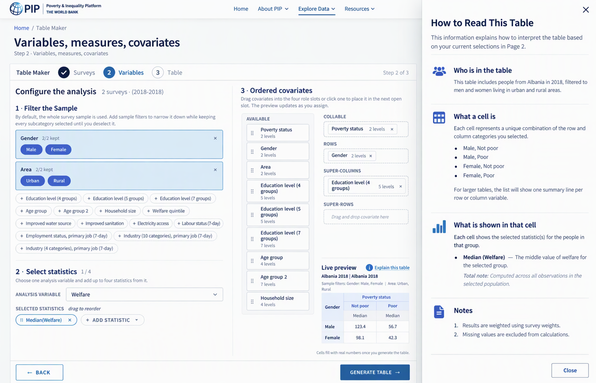
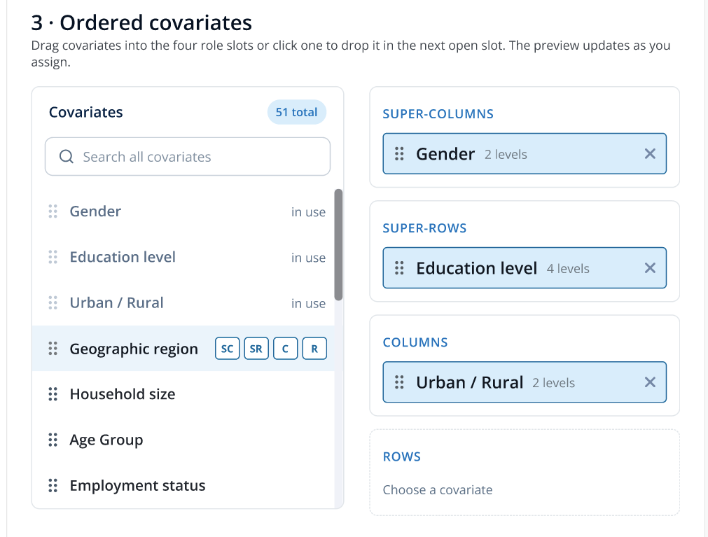

```{r}
#| label: setup-registry
#| include: false

registry_data <- tryCatch(
  {
    list(
      available   = TRUE,
      release     = piptm::piptm_current_release(),
      analysis    = piptm::piptm_analysis_variables(),
      filters     = piptm::piptm_filter_categories(),
      covariates  = piptm::piptm_layout_covariates(),
      stat_groups = piptm::piptm_stat_groups()
    )
  },
  error = function(e) {
    list(
      available     = FALSE,
      error_message = conditionMessage(e),
      release       = NA_character_,
      analysis      = list(),
      filters       = list(),
      covariates    = list(),
      stat_groups   = list()
    )
  }
)

fallback_note <- paste0(
  "_(Live registry data unavailable in this render environment",
  if (!is.null(registry_data$error_message)) {
    paste0(" -- ", registry_data$error_message)
  } else {
    ""
  },
  ". Set `PIPTM_REGISTRY_DIR` and `PIPTM_MANIFEST_DIR` and re-render for live figures.)_"
)

registry_overview_file <- "registry-overview.html"
live_metadata_file     <- "live-metadata.html"
live_api_result        <- NULL

if (registry_data$available) {
  tryCatch({
    root_dir <- normalizePath("../..", winslash = "/", mustWork = FALSE)

    # 1. Generate standalone PIP-styled registry overview HTML for the backup slide
    reg_script <- file.path(root_dir, "dev", "registry_overview.R")
    if (file.exists(reg_script)) {
      owd <- setwd(root_dir)
      on.exit(setwd(owd), add = TRUE)
      source(reg_script, local = new.env(parent = globalenv()))
      setwd(owd)
      tmp_reg <- file.path(Sys.getenv("TEMP"), "piptm_registry_overview.html")
      if (file.exists(tmp_reg)) {
        file.copy(tmp_reg, registry_overview_file, overwrite = TRUE)
      }
    }

    # 2. Pre-compute warm demo result & serialize with exact API serializer
    mf <- piptm::piptm_manifest()
    demo_pip_id <- if ("COL_2019_GEIH_INC_ALL" %in% mf$pip_id) {
      "COL_2019_GEIH_INC_ALL"
    } else {
      mf$pip_id[1L]
    }

    # Warm-up call (welfare by pov_status x gender @ $6.85/day)
    invisible(piptm::table_maker(
      pip_id       = demo_pip_id,
      analysis_var = "welfare",
      measures     = c("mean", "median", "gini"),
      by           = c("pov_status", "gender"),
      poverty_line = 6.85
    ))

    t0 <- proc.time()[["elapsed"]]
    dt_raw <- piptm::table_maker(
      pip_id       = demo_pip_id,
      analysis_var = "welfare",
      measures     = c("mean", "median", "gini"),
      by           = c("pov_status", "gender"),
      poverty_line = 6.85
    )
    elapsed_ms <- round((proc.time()[["elapsed"]] - t0) * 1000)

    batch10_ids <- c(
      "COL_2008_GEIH_INC_ALL",
      "ARG_2018_EPHC-S2_INC_ALL",
      "BOL_2005_EH_INC_ALL",
      "COL_2020_GEIH_INC_ALL",
      "BRA_2004_PNAD_INC_ALL",
      "PHL_2021_FIES_INC_ALL",
      "CHL_2006_CASEN_INC_ALL",
      "EST_2015_EU-SILC_INC_ALL",
      "LTU_2009_EU-SILC_INC_ALL",
      "URY_2002_ECH_INC_ALL"
    )
    batch10_ids <- intersect(batch10_ids, mf$pip_id)

    t10 <- proc.time()[["elapsed"]]
    invisible(piptm::table_maker(
      pip_id       = batch10_ids,
      analysis_var = "welfare",
      measures     = c("mean", "median", "gini"),
      by           = c("gender", "lstatus")
    ))
    elapsed_batch10_ms <- round((proc.time()[["elapsed"]] - t10) * 1000)

    # Render official PIP metadata HTML (/metadata endpoint)
    desc_model <- piptm::build_description_model(
      pip_id       = demo_pip_id,
      analysis_var = "welfare",
      measures     = c("mean", "median", "gini"),
      poverty_line = 6.85,
      column       = "pov_status",
      row          = "gender"
    )
    meta_html <- piptm::render_description_html(desc_model)
    writeLines(meta_html, live_metadata_file, useBytes = TRUE)

    dt_fmt <- piptm::format_table_output(dt_raw)
    serialized_demo <- piptm::serialize_table_response(
      dt           = dt_fmt,
      slots        = list(column = "pov_status", row = "gender", superColumn = NULL, superRow = NULL),
      analysis_var = "welfare",
      poverty_line = 6.85,
      measures     = c("mean", "median", "gini")
    )
    initial_json <- jsonlite::toJSON(serialized_demo, auto_unbox = TRUE, null = "null")

    live_api_result <- list(
      pip_id             = demo_pip_id,
      batch10_ids        = batch10_ids,
      elapsed_ms         = elapsed_ms,
      elapsed_batch10_ms = elapsed_batch10_ms,
      dt                 = dt_raw,
      initial_json       = as.character(initial_json)
    )
  }, error = function(e) NULL)
}
```

## Table Maker UI

```{=html}
<div class="ui-launch-card">
  <div class="ui-launch-info">
    <span class="ui-launch-tag">Live UAT Environment &middot; Interactive Walkthrough</span>
    <span class="ui-launch-url">https://pipuat.worldbank.org/table-maker</span>
  </div>
  <a href="https://pipuat.worldbank.org/table-maker" target="_blank" rel="noopener noreferrer" class="ui-launch-btn">
    Open Table Maker UI &nearr;
  </a>
</div>

<div class="ui-steps-grid">
  <div class="ui-step-box">
    <div class="ui-step-num">Step 1 &middot; Select Surveys</div>
    <div class="ui-step-title">Which surveys do I want to analyze?</div>
  </div>

  <div class="ui-step-box">
    <div class="ui-step-num">Step 2 &middot; Measure &amp; Slice</div>
    <div class="ui-step-title">How do I want to measure &amp; cut the data?</div>
  </div>

  <div class="ui-step-box">
    <div class="ui-step-num">Step 3 &middot; Results &amp; Export</div>
    <div class="ui-step-title">Here are my results</div>
  </div>
</div>
```

## Step 2 — Variables, Measures & How to Read This Table

```{=html}
<div class="ui-screenshot-wrap">
  
</div>
```

## Step 2 — Ordered Covariates

```{=html}
<div class="ui-screenshot-wrap">
  
</div>
```

## Live API Call: `/table` & `/metadata`

```{r}
#| echo: false
#| results: asis
if (!is.null(live_api_result)) {
  batch5_str  <- paste(utils::head(live_api_result$batch10_ids, 5L), collapse = ",")
  batch10_str <- paste(live_api_result$batch10_ids, collapse = ",")

  cat(sprintf(
    paste0(
      "```{=html}\n",
      "<div class='live-api-controls'>",
      "  <label for='tm-api-base'>API Server:</label>",
      "  <select id='tm-api-env' onchange='tmSelectEnv(this.value)'>",
      "    <option value='http://127.0.0.1:8080' selected>Local Server (127.0.0.1:8080)</option>",
      "    <option value='https://tablemakerapiqa.worldbank.org'>WB QA Server (tablemakerapiqa.worldbank.org)</option>",
      "  </select>",
      "  <input id='tm-api-base' class='url-input' type='text' value='http://127.0.0.1:8080' oninput='tmUpdatePreset()' />",
      "  <label for='tm-preset'>Preset:</label>",
      "  <select id='tm-preset' onchange='tmUpdatePreset()'>",
      "    <option value='1' data-pip='%s' data-var='welfare' data-measures='mean,median,gini' data-pline='6.85' data-col='pov_status' data-row='gender'>1 Survey: Welfare (Mean, Median, Gini) &times; Poverty Status &amp; Gender</option>",
      "    <option value='pov' data-pip='%s' data-var='pov_status' data-measures='headcount,poverty_gap,severity' data-pline='6.85' data-col='area' data-row='age_group'>1 Survey: Poverty @ &#36;6.85/day (FGT0, FGT1, FGT2) &times; Area &amp; Age Group</option>",
      "    <option value='5' data-pip='%s' data-var='welfare' data-measures='mean,median,gini' data-pline='' data-col='wquintile' data-row='hsize_group'>5 Surveys Batch: Welfare &times; Welfare Quintile &amp; Household Size</option>",
      "    <option value='10' data-pip='%s' data-var='welfare' data-measures='mean,median,gini' data-pline='' data-col='gender' data-row='lstatus'>10 Surveys Batch: Welfare &times; Gender &amp; Labour Status</option>",
      "  </select>",
      "  <button type='button' class='live-api-btn' onclick='tmRunLiveApi()'>&#9654; Send Live Request</button>",
      "  <a id='tm-swagger-link' href='http://127.0.0.1:8080/__docs__/' target='_blank' rel='noopener' class='live-api-btn btn-secondary'>Swagger UI &nearr;</a>",
      "  <a id='tm-meta-link' href='%s' target='_blank' rel='noopener' class='live-api-btn btn-secondary'>Metadata HTML &nearr;</a>",
      "</div>",
      "<div class='api-call-banner'>",
      "  <span style='overflow:hidden;text-overflow:ellipsis;white-space:nowrap;'><code id='tm-query-preview'>GET http://127.0.0.1:8080/table?analysis_var=welfare&amp;pip_id=%s&amp;measures=mean&amp;measures=median&amp;measures=gini&amp;poverty_line=6.85&amp;column=pov_status&amp;row=gender&amp;ppp=2021&amp;pop_share_threshold=0.001</code></span>",
      "  <span id='tm-timing-badge' class='timing-pill'>Engine warm: <b>%d ms</b> (1 survey) &middot; <b>%d ms</b> (10 surveys)</span>",
      "</div>",
      "<div class='tm-ui-result-header'>",
      "  <div id='tm-survey-tabs' class='tm-survey-tabs'></div>",
      "  <div class='tm-view-toggle'>",
      "    <span>View:</span>",
      "    <button type='button' id='tm-btn-ui' class='tm-view-btn active' onclick=\"tmSetViewMode('ui')\">Step 3 UI Cross-Tab</button>",
      "    <button type='button' id='tm-btn-meta' class='tm-view-btn' onclick=\"tmSetViewMode('meta')\"><code>/metadata</code> HTML Document</button>",
      "  </div>",
      "</div>",
      "<div class='live-table-wrap'>",
      "  <div id='tm-result-container'></div>",
      "</div>",
      "<script>window.TM_INITIAL_SURVEYS = %s; window.TM_INITIAL_META_FILE = '%s';</script>\n```\n"
    ),
    live_api_result$pip_id,
    live_api_result$pip_id,
    batch5_str,
    batch10_str,
    live_metadata_file,
    live_api_result$pip_id,
    live_api_result$elapsed_ms,
    live_api_result$elapsed_batch10_ms,
    live_api_result$initial_json,
    live_metadata_file
  ))
} else {
  cat(fallback_note, "\n")
}
```

```{=html}
<script>
var tmCurrentSurveys = window.TM_INITIAL_SURVEYS || [];
var tmCurrentMetaHtml = null;
var tmActiveSurveyIdx = 0;
var tmViewMode = 'ui'; // 'ui', 'flat', or 'meta'

var tmMeasureLabels = {
  mean: 'Mean ($/day PPP)',
  median: 'Median ($/day PPP)',
  gini: 'Gini Index (%)',
  pop_share: 'Population Share (%)',
  headcount: 'Poverty Rate (%)',
  poverty_gap: 'Poverty Gap (%)',
  severity: 'Poverty Severity',
  watts: 'Watts Index'
};

function tmUnbox(x) {
  if (Array.isArray(x)) return x.length ? x[0] : null;
  if (x && typeof x === 'object' && Object.keys(x).length === 0) return null;
  return x;
}

function tmBuildParams() {
  var sel = document.getElementById('tm-preset');
  var opt = sel.options[sel.selectedIndex];
  var pips = opt.getAttribute('data-pip').split(',');
  var avar = opt.getAttribute('data-var');
  var measures = opt.getAttribute('data-measures').split(',');
  var pline = opt.getAttribute('data-pline');
  var col = opt.getAttribute('data-col');
  var row = opt.getAttribute('data-row');

  var parts = [];
  parts.push('analysis_var=' + encodeURIComponent(avar));
  for (var i = 0; i < pips.length; i++) {
    parts.push('pip_id=' + encodeURIComponent(pips[i]));
  }
  for (var j = 0; j < measures.length; j++) {
    parts.push('measures=' + encodeURIComponent(measures[j]));
  }
  if (pline) parts.push('poverty_line=' + encodeURIComponent(pline));
  if (col) parts.push('column=' + encodeURIComponent(col));
  if (row) parts.push('row=' + encodeURIComponent(row));
  parts.push('ppp=2021');
  parts.push('pop_share_threshold=0.001');
  return { query: parts.join('&'), measures: measures, avar: avar, nSurveys: pips.length };
}

function tmSelectEnv(val) {
  document.getElementById('tm-api-base').value = val;
  var sw = document.getElementById('tm-swagger-link');
  if (sw) sw.href = val.replace(/\/+$/, '') + '/__docs__/';
  tmUpdatePreset();
}

function tmUpdatePreset() {
  var base = document.getElementById('tm-api-base').value.replace(/\/+$/, '');
  var sw = document.getElementById('tm-swagger-link');
  if (sw) sw.href = base + '/__docs__/';
  var p = tmBuildParams();
  document.getElementById('tm-query-preview').textContent = 'GET ' + base + '/table?' + p.query;
  var ml = document.getElementById('tm-meta-link');
  if (ml) ml.href = base + '/metadata?' + p.query + '&format=html';
}

function tmSetViewMode(mode) {
  tmViewMode = mode;
  document.getElementById('tm-btn-ui').className   = 'tm-view-btn' + (mode === 'ui'   ? ' active' : '');
  document.getElementById('tm-btn-meta').className = 'tm-view-btn' + (mode === 'meta' ? ' active' : '');
  tmRenderResult();
}

function tmSelectSurveyTab(idx) {
  tmActiveSurveyIdx = idx;
  tmRenderResult();
}

function tmRenderResult() {
  var container = document.getElementById('tm-result-container');
  var tabsEl = document.getElementById('tm-survey-tabs');
  if (!container || !tmCurrentSurveys || !tmCurrentSurveys.length) return;

  if (tmActiveSurveyIdx >= tmCurrentSurveys.length) tmActiveSurveyIdx = 0;

  if (tmViewMode === 'ui') {
    var tabsHtml = '';
    for (var i = 0; i < tmCurrentSurveys.length; i++) {
      var s = tmCurrentSurveys[i];
      var pid = tmUnbox(s.pip_id);
      var cls = (i === tmActiveSurveyIdx) ? 'tm-survey-tab active' : 'tm-survey-tab';
      tabsHtml += '<button type="button" class="' + cls + '" onclick="tmSelectSurveyTab(' + i + ')">' + pid + '</button>';
    }
    tabsEl.innerHTML = tabsHtml;
  } else if (tmViewMode === 'flat') {
    tabsEl.innerHTML = '<span style="font-size:0.54em;color:#485664;font-weight:600;">Exact schema produced by <code>flatten_table_response()</code> / <code>POST /table/download</code>:</span>';
  } else {
    tabsEl.innerHTML = '<span style="font-size:0.54em;color:#485664;font-weight:600;">Live HTML provenance document produced by <code>GET /metadata</code>:</span>';
  }

  if (tmViewMode === 'ui') {
    var sv = tmCurrentSurveys[tmActiveSurveyIdx];
    var mList = Array.isArray(sv.measures) ? sv.measures.map(tmUnbox) : [tmUnbox(sv.measures)];
    var rowSlot = sv.layout ? sv.layout.rows : null;
    var colSlot = sv.layout ? sv.layout.columns : null;
    var rowCats = (rowSlot && Array.isArray(rowSlot.categories)) ? rowSlot.categories : [];
    var colCats = (colSlot && Array.isArray(colSlot.categories)) ? colSlot.categories : [];

    var rowDimLabel = (rowSlot && rowSlot.label) ? tmUnbox(rowSlot.label) : 'Row';
    var colDimLabel = (colSlot && colSlot.label) ? tmUnbox(colSlot.label) : 'Column';

    var cellMap = {};
    var cells = sv.cells || [];
    for (var c = 0; c < cells.length; c++) {
      var cell = cells[c];
      var rKey = (cell.row && cell.row.label) ? String(tmUnbox(cell.row.label)) : '__ALL__';
      var cKey = (cell.column && cell.column.label) ? String(tmUnbox(cell.column.label)) : '__ALL__';
      cellMap[rKey + '||' + cKey] = cell.measures || {};
    }

    var html = '<table class="tm-crosstab-matrix"><thead><tr>';
    html += '<th class="corner-hdr">' + rowDimLabel + ' \\ ' + colDimLabel + '</th>';
    for (var j = 0; j < colCats.length; j++) {
      html += '<th>' + tmUnbox(colCats[j].label) + '</th>';
    }
    html += '</tr></thead><tbody>';

    for (var r = 0; r < rowCats.length; r++) {
      var rLbl = String(tmUnbox(rowCats[r].label));
      html += '<tr><td class="row-hdr">' + rLbl + '</td>';
      for (var k = 0; k < colCats.length; k++) {
        var cLbl = String(tmUnbox(colCats[k].label));
        var mObj = cellMap[rLbl + '||' + cLbl] || {};
        html += '<td><div class="tm-cell-stack">';
        for (var m = 0; m < mList.length; m++) {
          var mKey = mList[m];
          var val = tmUnbox(mObj[mKey]);
          if (val === undefined || val === null) val = '—';
          html += '<div class="tm-cell-item"><span class="tm-cell-lbl">' + (tmMeasureLabels[mKey] || mKey) + '</span><span class="tm-cell-val">' + val + '</span></div>';
        }
        html += '</div></td>';
      }
      html += '</tr>';
    }
    html += '</tbody></table>';
    container.innerHTML = html;

  } else if (tmViewMode === 'flat') {
    var first = tmCurrentSurveys[0];
    var mListFlat = Array.isArray(first.measures) ? first.measures.map(tmUnbox) : [tmUnbox(first.measures)];
    var rowVarname = (first.layout && first.layout.rows && first.layout.rows.varname) ? tmUnbox(first.layout.rows.varname) : 'area';
    var colVarname = (first.layout && first.layout.columns && first.layout.columns.varname) ? tmUnbox(first.layout.columns.varname) : 'gender';

    var fHtml = '<table><thead><tr>' +
      '<th><code>pip_id</code></th>' +
      '<th><code>country_code</code></th>' +
      '<th><code>surveyid_year</code></th>' +
      '<th><code>welfare_type</code></th>' +
      '<th><code>analysis_var</code></th>' +
      '<th><code>poverty_line</code></th>' +
      '<th><code>' + rowVarname + '</code></th>' +
      '<th><code>' + colVarname + '</code></th>';
    for (var mf = 0; mf < mListFlat.length; mf++) {
      fHtml += '<th><code>' + mListFlat[mf] + '</code></th>';
    }
    fHtml += '</tr></thead><tbody>';

    for (var sIdx = 0; sIdx < tmCurrentSurveys.length; sIdx++) {
      var svf = tmCurrentSurveys[sIdx];
      var pl = tmUnbox(svf.poverty_line);
      var plStr = (pl !== null && pl !== undefined && pl !== '') ? pl : 'NA';
      var fCells = svf.cells || [];
      for (var cIdx = 0; cIdx < fCells.length; cIdx++) {
        var fc = fCells[cIdx];
        var rVal = (fc.row && fc.row.label) ? tmUnbox(fc.row.label) : 'All';
        var cVal = (fc.column && fc.column.label) ? tmUnbox(fc.column.label) : 'All';
        fHtml += '<tr>' +
          '<td><code>' + tmUnbox(svf.pip_id) + '</code></td>' +
          '<td>' + tmUnbox(svf.country_code) + '</td>' +
          '<td>' + tmUnbox(svf.surveyid_year) + '</td>' +
          '<td>' + tmUnbox(svf.welfare_type) + '</td>' +
          '<td>' + tmUnbox(svf.analysis_var) + '</td>' +
          '<td>' + plStr + '</td>' +
          '<td>' + rVal + '</td>' +
          '<td>' + cVal + '</td>';
        for (var mk = 0; mk < mListFlat.length; mk++) {
          var mv = fc.measures ? tmUnbox(fc.measures[mListFlat[mk]]) : '—';
          fHtml += '<td><b>' + (mv !== null && mv !== undefined ? mv : '—') + '</b></td>';
        }
        fHtml += '</tr>';
      }
    }
    fHtml += '</tbody></table>';
    container.innerHTML = fHtml;

  } else {
    if (tmCurrentMetaHtml) {
      container.innerHTML = '<iframe class="registry-iframe" style="height:390px;" title="Table Maker Live Metadata"></iframe>';
      container.querySelector('iframe').srcdoc = tmCurrentMetaHtml;
    } else {
      container.innerHTML = '<iframe class="registry-iframe" style="height:390px;" src="' + (window.TM_INITIAL_META_FILE || 'live-metadata.html') + '" title="Table Maker Live Metadata"></iframe>';
    }
  }
}

document.addEventListener('DOMContentLoaded', function() {
  tmRenderResult();
});

async function tmRunLiveApi() {
  var base = document.getElementById('tm-api-base').value.replace(/\/+$/, '');
  var p = tmBuildParams();
  var tableUrl = base + '/table?' + p.query;
  var metaUrl  = base + '/metadata?' + p.query + '&format=html';
  document.getElementById('tm-query-preview').textContent = 'GET ' + tableUrl;

  var badge = document.getElementById('tm-timing-badge');
  badge.className = 'timing-pill';
  badge.innerHTML = 'Sending live request&hellip;';

  try {
    var t0 = performance.now();
    var resp = await fetch(tableUrl, { headers: { 'Accept': 'application/json' } });
    var elapsed = Math.round(performance.now() - t0);

    if (!resp.ok) {
      throw new Error('HTTP ' + resp.status);
    }
    var payload = await resp.json();
    var st = tmUnbox(payload && payload.status);
    if (!payload || st !== 'success' || !Array.isArray(payload.data)) {
      throw new Error('Unexpected API response shape');
    }

    tmCurrentSurveys = payload.data;
    tmActiveSurveyIdx = 0;

    // Fetch live /metadata HTML in parallel for both the inline view and the Metadata slide
    try {
      var mResp = await fetch(metaUrl);
      if (mResp.ok) {
        tmCurrentMetaHtml = await mResp.text();
        var metaFrame = document.getElementById('tm-live-metadata-frame');
        if (metaFrame) {
          metaFrame.removeAttribute('src');
          metaFrame.srcdoc = tmCurrentMetaHtml;
        }
      }
    } catch (metaErr) {}

    tmRenderResult();

    badge.className = 'timing-pill status-ok';
    badge.innerHTML = 'Live HTTP 200 OK in <b>' + elapsed + ' ms</b> (' + tmCurrentSurveys.length + ' survey' + (tmCurrentSurveys.length > 1 ? 's' : '') + ')';
  } catch (err) {
    badge.className = 'timing-pill status-warn';
    badge.innerHTML = 'API request failed (' + err.message + ') &mdash; showing pre-rendered result';
  }
}
</script>
```

## Live Metadata Output: `/metadata`

```{r}
#| echo: false
#| results: asis
if (file.exists(live_metadata_file) && !is.null(live_api_result)) {
  cat(sprintf(
    paste0(
      "<div class='registry-link-bar' style='justify-content:flex-end;'>",
      "<a href='%s' target='_blank' rel='noopener'>Open in new tab &rarr;</a>",
      "</div>",
      "<div class='registry-iframe-wrap'>",
      "<iframe id='tm-live-metadata-frame' class='registry-iframe' src='%s' title='Table Maker Live Metadata'></iframe>",
      "</div>"
    ),
    live_metadata_file, live_metadata_file
  ))
} else {
  cat(fallback_note, "\n")
}
```

---

::: {.backup-slide}
## Backup: Live Registry Catalogue

```{r}
#| echo: false
#| results: asis
if (file.exists(registry_overview_file)) {
  cat(sprintf(
    paste0(
      "<div class='registry-link-bar' style='justify-content:flex-end;'>",
      "<a href='%s' target='_blank' rel='noopener'>Open in new tab &rarr;</a>",
      "</div>",
      "<div class='registry-iframe-wrap'>",
      "<iframe class='registry-iframe' src='%s' title='Table Maker Registry Overview'></iframe>",
      "</div>"
    ),
    registry_overview_file, registry_overview_file
  ))
} else {
  cat(fallback_note, "\n")
}
```
:::
